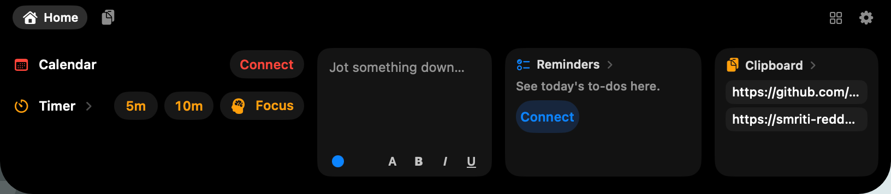

<p align="center">
  
</p>

<h1 align="center">Pocket</h1>

<p align="center"><b>A little pocket at the top of my Mac. 👖</b></p>

<p align="center">
  
</p>

---

My MacBook's notch just sat there. Now it's a pocket: it pops open when something's happening
and tucks away when nothing is. Think iPhone Dynamic Island, but for my Mac.

**Click the notch** and reach in for:

- 📝 a **scratchpad** you can type into right there
- ✅ today's **reminders**, ready to tick off
- 📋 your last few **copies**, one click to copy again
- 📅 your next **event** and ⏱️ one-tap **timers** and Focus sessions

**Click it again** and it zips shut.

Hover over it and a little face peeks out to say hi.

<p align="center">
  
</p>

It also gives you a heads-up before meetings, a file tray, a stopwatch, a camera mirror and
Keep Awake. That's it: no music, no calls, no battery or volume pop-ups. Just the good stuff.

No account, no tracking, never phones home. 🔒

## Get it running

You'll need macOS 14+ and Apple's developer tools (`xcode-select --install`). Then:

```bash
Scripts/build-app.sh
```

Drag `build/Pocket.app` into Applications, open it, and you're in.

👉 **[How to use it](docs/HOW-TO-USE.md)** — every click, swipe and shortcut.

## Credit where it's due

Built on [Dynamic Notch](https://github.com/shandilyaswagat/dynamic_notch) by Swagat Shandilya.
I stripped it down to what I actually use, made a second click close the notch, packed more onto
Home and added a face that peeks out to say hi.
